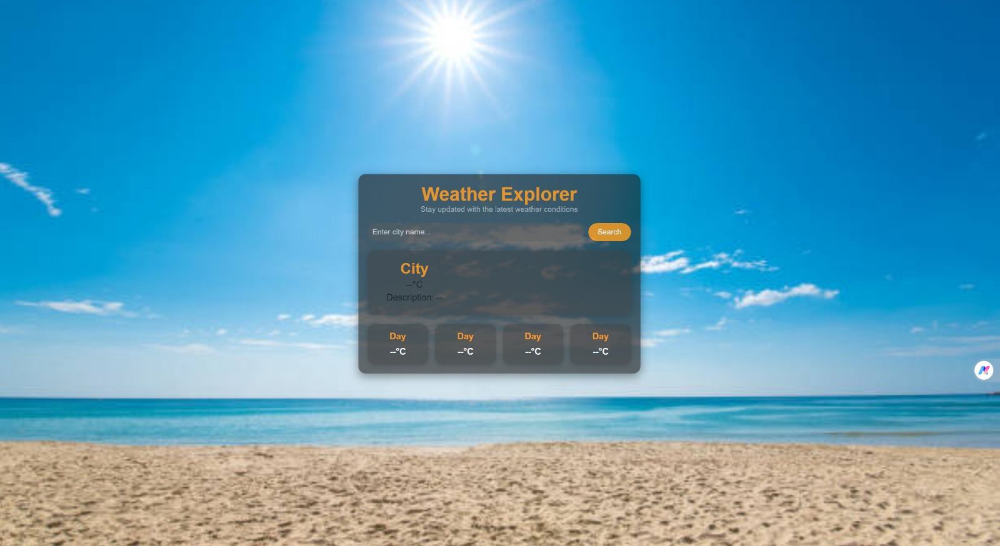
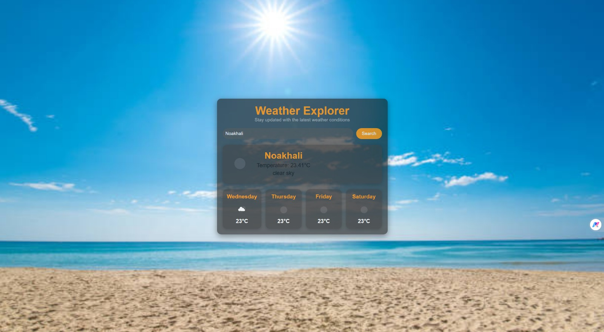

# 🌤️ Weather Explorer

A clean, responsive weather app built with vanilla HTML, CSS, and JavaScript. Search for any city to see its current temperature and conditions, plus a four-day forecast, all powered by the [OpenWeatherMap API](https://openweathermap.org/api).

No frameworks, no build tools, no dependencies. Just open it in a browser.

---

## 📸 Screenshots

### Home screen
The app on first load, ready for a city search.



### Search result
Searching for a city (here, Noakhali) shows the current temperature and conditions, plus the upcoming forecast days.



---

## ✨ Features

- **City search**: type any city name and get instant results
- **Current conditions**: city name, temperature (°C), and a weather description
- **4-day forecast**: weekday, icon, and temperature for each upcoming day
- **Weather icons**: official OpenWeatherMap icons for current and forecast conditions
- **Modern dark UI**: semi-transparent card over a full-screen background image, with orange accents
- **Responsive layout**: scales down for tablets and phones

## 🛠️ Tech Stack

| Layer   | Technology                                   |
| ------- | -------------------------------------------- |
| Markup  | HTML5                                        |
| Styling | CSS3 (Flexbox, Grid)                         |
| Logic   | JavaScript (ES6+, `async/await`, Fetch API)  |
| Data    | OpenWeatherMap Current Weather & 5-Day Forecast APIs |

## 📁 Project Structure

```
Weather App/
├── index.html    # Page structure: search bar, current weather, forecast cards
├── script.js     # API calls, DOM updates, background switching helper
├── styles.css    # Layout, theme, and dynamic background styles
└── screenshots/  # Images used in this README
    ├── home.jpeg
    └── search-result.jpeg
```

## 🚀 Getting Started

### 1. Get a free API key

1. Create an account at [openweathermap.org](https://openweathermap.org/api).
2. Copy your key from the **API keys** tab. New keys can take a little while to activate.

### 2. Add your key

Open `script.js` and replace the placeholder on the `apiKey` line:

```js
const apiKey = 'Your_own_API'; // ← paste your OpenWeatherMap key here
```

### 3. Run the app

Open `index.html` in your browser. Or, if you prefer a local server:

```bash
# Python
python -m http.server 8000

# or Node
npx serve
```

Then visit `http://localhost:8000`.

## 🔍 How It Works

1. The user enters a city and clicks **Search**, which calls `getWeather()`.
2. The app makes two requests to OpenWeatherMap, both with `units=metric`:
   - `/data/2.5/weather` for current conditions
   - `/data/2.5/forecast` for the 5-day / 3-hour forecast
3. The current weather card is filled with the city name, temperature, description, and icon.
4. The forecast API returns data in 3-hour steps, so the app picks every 8th entry (`index * 8`) to get one reading per 24 hours, then renders each as a day card.

## ⚠️ Security Note

This is a client-side app, so your API key is visible to anyone who views the page source. That's fine for learning and personal projects on a free key. For anything public, route requests through a small backend or serverless function that holds the key. **Never commit your real API key to a public repository.**

## 🧭 Known Limitations & Roadmap

Things to improve next:

- [ ] **Error handling**: show a friendly message for invalid cities, network failures, or a bad API key (currently errors are only logged to the console)
- [ ] **Dynamic backgrounds**: `changeBackground()` is written in `script.js` and the CSS classes exist, but the function isn't called yet, and all conditions currently use the same image. Call it with the weather condition and give each class its own image.
- [ ] **Search on Enter**: trigger the search with the Enter key
- [ ] **Unit toggle**: switch between °C and °F
- [ ] **Geolocation**: load weather for the user's current location on start
- [ ] **Extra details**: humidity, wind speed, "feels like", sunrise/sunset
- [ ] **Loading state**: spinner while data is being fetched
- [ ] **URL-encode the city name** with `encodeURIComponent()` for names with spaces or special characters

## 🙌 Credits

- Weather data and icons: [OpenWeatherMap](https://openweathermap.org/)
- Background imagery: [Pexels](https://www.pexels.com/) / [iStock](https://www.istockphoto.com/). Replace with images you have the rights to use before publishing.

## 📄 License

This project is open source and available under the [MIT License](LICENSE). Add a `LICENSE` file if you publish it.

